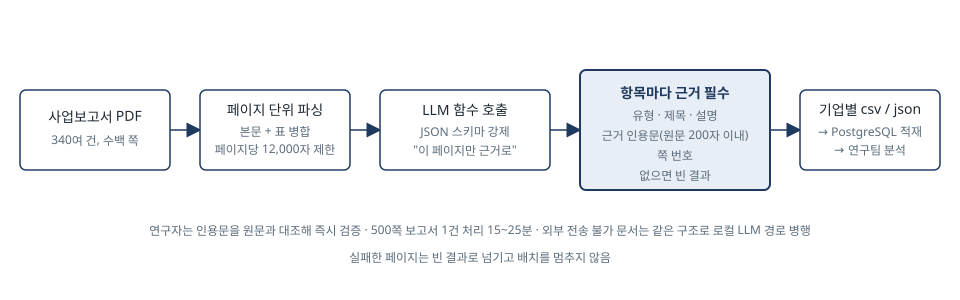

# LLM 문서 추출 파이프라인

## 사업보고서 340건을 근거 인용문이 붙은 데이터로 바꾼 3개월

**배경** 한국과학기술정보연구원 연구팀은 사업보고서 수백 건에서 연구개발 기술과 투자 계획을 수작업으로 옮기고 있었습니다. LLM으로 자동화하되, 항목의 출처를 사람이 바로 확인할 수 없으면 연구 데이터로 쓸 수 없었습니다.

**목표** 3개월 계약 기간 안에 340여 건을 처리하고, 다른 연구자가 이어받을 수 있는 형태로 남기는 것.

**설계 판단**

| 과제 | 선택 | 근거 |
|---|---|---|
| 보고서 전체 입력 시 문맥 혼재, 재무제표 잡음 유입 | 페이지 단위로 본문과 표를 함께 파싱해 "이 페이지만 근거로" 판단하게 함 | 교차 오염 차단, 토큰 상한 관리 |
| 자유 서술 응답은 DB 적재 불가 | 함수 호출로 JSON 스키마 강제: 유형·제목·설명·근거 인용문·쪽 번호 필수 | 스키마 위반 응답 제거, csv와 DB로 바로 연결 |
| LLM 환각 | 근거 인용문이 없으면 빈 결과를 내도록 규칙화 | 연구자가 원문 대조로 즉시 검증 |

**결과** 340여 건을 처리해 통합 항목 183,398건을 PostgreSQL에 적재했고, 500쪽 보고서 1건은 15~25분에 처리했습니다. 외부 전송이 안 되는 문서용 로컬 LLM 경로를 병행했고, 계약 마지막 날 인수인계 문서를 남겼습니다.

*그림 1. 추출 파이프라인. 강조된 단계가 설계의 핵심으로, 모든 항목에 근거 인용문과 쪽 번호를 강제해 사람이 원문과 대조할 수 있게 했다.*

**한계와 향후 과제** 정답 라벨이 없어 정확도를 재지 못했습니다. 샘플 32건을 직접 분류하니 투자 계획은 근거가 분명했지만 연구개발 기술 유형은 정관 문구가 섞이는 잡음이 컸습니다. 목차 페이지 제외, 유형 정의 강화, 라벨 100건 정량 평가 순으로 개선할 계획입니다.

**역할 및 기술** 단독 개발, 2025.08~11. Python, OpenAI API, pdfplumber, Ollama, Docker, PostgreSQL. [코드·샘플·오류 분석 (비밀 Gist)](https://gist.github.com/iceteaTO/ccbcf133642911de86516de662b89cfa)
