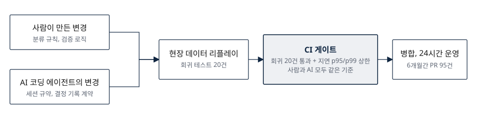

# LiDAR 인식 시스템 검증 체계

## 24시간 운영 시스템의 모든 변경이 같은 기준을 통과하게 만든 회귀 테스트 20건과 CI 게이트

**문제** 지에스아이 연구소에서 항만 자동화 크레인용 LiDAR 컨테이너 인식 시스템의 상부 유형 분류와 검증 모듈을 맡았습니다. 결과가 크레인 동작에 바로 반영되어 오판은 안전 문제인데, 오탐을 고칠 때마다 다른 장면이 망가지는지 확인할 방법이 없었습니다.

**목표** 알고리즘을 손보기 전에 검증 기준부터 만들어, 모든 변경이 같은 기준을 통과해야 병합되게 하는 것.

**판단**

| 문제 | 선택 | 이유 |
|---|---|---|
| 프레임별 정답 비교는 센서 노이즈에 너무 민감 | 실제 현장 점군과 PLC 신호를 재생하는 회귀 테스트 20건을 기준선으로 고정하고, 구간 다수결과 미분류 비율의 상하한으로 판정 | 노이즈는 허용하되 성능 후퇴만 잡아냄 |
| 정확도가 맞아도 느려지면 현장에서 못 씀 | 응답 지연 p95와 p99 상한을 CI 게이트로 추가 | 병합 전에 지연 회귀를 자동 차단 |
| AI 코딩 에이전트의 변경을 어떻게 믿을까 | 에이전트가 작업 전 읽어야 하는 세션 규약과 결정 기록 계약을 두고, 에이전트의 변경도 같은 게이트로 검사 | 사람과 AI 모두 근거 없는 변경을 넣을 수 없게 |

**결과** 6개월간 PR 95건이 이 절차를 거쳐 병합되었습니다. 인식 결과는 원본 데이터와 함께 기록해 사후 재현이 가능하고, 오탐 원인과 개선은 결정 기록 문서로 남겼습니다. 릴리스 노트의 잘못된 설정값은 배포 뒤였지만 바로 정정 기록을 남겼습니다.

*그림 2. 검증 흐름. 누가 만든 변경이든 같은 회귀 테스트와 지연 게이트를 통과해야 24시간 운영 시스템에 들어간다.*

**한계와 다음 단계** 기준선 20건은 현장 장면의 일부라 새 유형의 오탐은 사후에 추가됩니다. 기준선 확장과 라벨 없는 장면의 이상 탐지가 다음 과제입니다.

**역할·기간·기술** 분류·검증 모듈, 회귀 테스트, CI 게이트 주도. 런타임 추적은 참여. 2026.03~현재. Python, NumPy, pytest, GitHub Actions, Claude Code, Cursor. 코드는 회사 저장소라 비공개.
