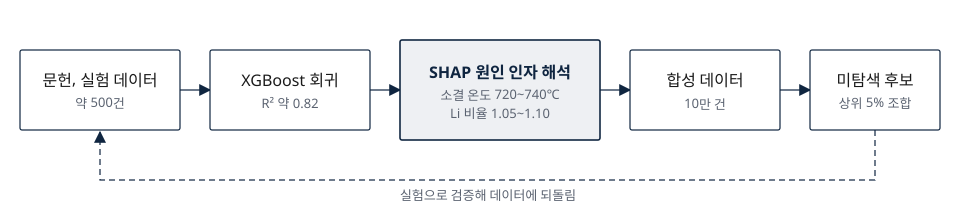

# 양극재 성능 예측과 원인 해석

## 약 500건 데이터로 R² 0.82, SHAP 해석과 합성 데이터 10만 건으로 미탐색 후보 제안

**배경** 리튬이온배터리 양극재는 조성비와 소성 조건이 비선형으로 얽혀 실험만으로 최적 조건을 찾기 어렵습니다. 기존 데이터 연구는 예측 정확도에 집중해 어떤 변수가 왜 성능을 좌우하는지 설명하지 못했습니다.

**목표** 조성과 공정 변수를 한 모델에서 다루고, 해석 결과를 설계에 되돌리는 프레임워크를 완성하는 것.

**설계 판단**

| 과제 | 선택 | 근거 |
|---|---|---|
| 문헌마다 변수 표기와 단위가 상이 | 단위 보정, 결측·이상치 처리 기준을 기록하고 도펀트는 원자번호 같은 수치 특성으로 대치 | 기준 없이는 같은 데이터로도 결과가 달라짐 |
| 적은 데이터에서 과적합 | XGBoost 회귀에 5겹 교차검증, Grid Search, 조기 종료 | 소규모 데이터에서 안정적인 일반화 |
| 예측값만으로는 실험 설계에 활용 불가 | SHAP으로 인자별 기여와 유효 구간을 해석하고, 그 구간 안에서 합성 데이터를 생성해 후보를 탐색 | 예측이 아니라 이유를 실험자에게 전달 |

**결과** 용량유지율 모델 R² 약 0.82. SHAP으로 2단계 소결 온도 720~740℃와 Li 비율 1.05~1.10 구간의 양의 기여를 밝히고, 합성 데이터 10만 건으로 용량과 유지율이 동시에 상위 5%인 미탐색 후보를 제안했습니다. StatPhys29(2025.07, 피렌체)와 한국물리학회에서 발표했고, 논문은 SCIE 저널 Surfaces and Interfaces에 공동 제1저자로 투고해 심사 중입니다.

*그림 3. 연구 프레임워크. 강조된 해석 단계가 예측을 설계로 바꾸는 연결점이다.*

**한계와 향후 과제** 데이터가 희소한 경계 구간은 예측 편차가 컸습니다. 밀도 가중과 불확실성 정량화로 외삽 신뢰도를 보정하는 것이 다음 과제입니다.

**역할 및 기술** 데이터 정제, 모델링, 해석, 논문 작성 수행. 2024.01~2026.02. Python, XGBoost, SHAP, scikit-learn. 석사 학위논문(2026.02).
